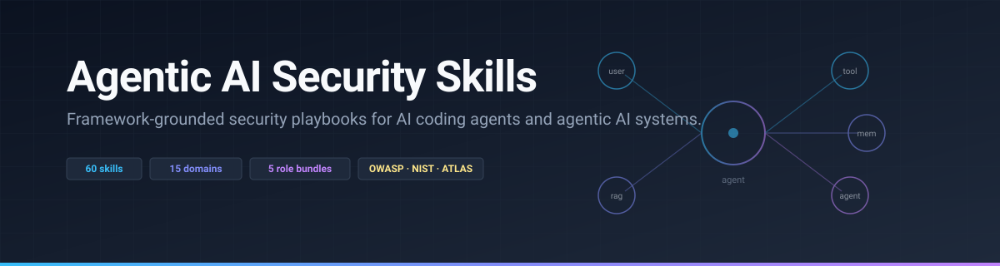
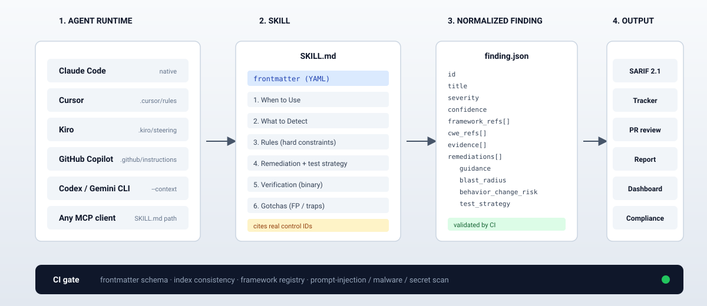

<p align="center">
  
</p>

<p align="center">
  
  
  
  
  
  
  
  
  
</p>

<p align="center">
  <a href="#quick-start">Quick Start</a> ·
  <a href="#what-it-does">What It Does</a> ·
  <a href="#skills-catalog">Skills Catalog</a> ·
  <a href="#architecture">Architecture</a> ·
  <a href="./CONTRIBUTING.md">Contributing</a> ·
  <a href="./docs">Documentation</a>
</p>

---

Agentic AI systems — agents that reason, invoke tools, retain memory, and coordinate with other agents — introduce an entirely new security layer that traditional application security and generic LLM guidance do not cover. Teams reviewing these systems repeatedly discover the same gaps: tool parameters generated by the model are trusted where user parameters are validated; memory writes bypass input filters; audit trails sit in the same account the agent can write to; prompt injection is defended at the user prompt but not in retrieved content.

**This repository closes those gaps with 60 structured review playbooks that any AI coding agent can load and run.**

---

## What It Does

| | Capability | Description |
|---|-----------|-------------|
| 🧠 | **Memory Security Review** | Partitioning, tamper detection, cross-session isolation, hallucination-propagation controls |
| 🔧 | **Tool & MCP Security** | Model-generated parameter validation, authorization, registry governance |
| 👤 | **Agent Identity** | Agent-vs-human separation, least privilege, dynamic boundaries, adaptive auth |
| 🛡 | **Guardrails & HITL** | Tiered alignment controls, risk-tiered human approval, multi-reviewer consensus |
| 📝 | **Observability** | Tamper-evident decision logging, distributed tracing, behavioural baselines |
| 🕸 | **Multi-Agent** | Message signing, trust boundaries, orchestration security, coordination anomalies |
| 🚨 | **Containment & IR** | Automated anomaly containment, forensic preservation, emergency shutdown |
| 🎯 | **I/O & Prompt Injection** | Multi-layer input validation, indirect injection defense, output filtering |
| 🧪 | **Testing & Red Team** | Automated prompt testing, agentic pen test, sandboxing, SDLC-wide scanning |
| 📊 | **Lifecycle & Governance** | Prompts-as-code, CI/CD quality gates, portfolio governance, model card review |

Every skill cites real control IDs from published frameworks and emits normalized JSON that validates against a shared schema.

---

## Why This Matters

```
Tools trust model-generated parameters → prompt injection = direct exploit
Memory writes bypass user-input filters → one affected session poisons all
Audit trail in same account as agent → affected agent edits its own history
Manual containment on anomaly → agent runs outside scope for hours
Prompt injection defended on user input, not retrieved → RAG as attack vector
```

**Real-world agentic risks these skills catch:**

- An agent tool trusts a model-generated `appointment_id` and runs an unparameterized SQL update
- A RAG pipeline concatenates retrieved documents into the prompt — one poisoned document executes instructions
- An agent operates under a user's IAM role so audit logs can't distinguish agent action from human action
- A multi-agent workflow passes instructions over SQS with TLS but no message signing — instructions in the queue can't be verified at consumption
- Output filtering catches PII on the user response but misses the inter-agent message carrying the same PII

---

## Quick Start

```bash
git clone https://github.com/josephtui767-cloud/agentic-ai-security-skills.git
cd agentic-ai-security-skills
```

Install for your agent runtime:

```bash
# Claude Code — auto-discovered
cp -r skills/*/* ~/.claude/skills/

# Cursor
cp -r skills/ .cursor/rules/

# Kiro
cp -r skills/ .kiro/steering/

# Codex CLI / Gemini CLI / Copilot / any MCP client
# Point the agent at a specific SKILL.md
```

Usage:

```
> Review this agent for memory isolation issues
  → auto-loads memory-isolation

> /tool-parameter-validation
  → direct invocation

> /indirect-prompt-injection-defense src/agent/rag.py
  → with arguments
```

Local validation (same as CI runs):

```bash
make validate     # frontmatter + index + framework registry + injection scan
```

---

## Skills Catalog

60 skills across 15 agentic-security domains.

| Domain | Count | Covers |
|---|:-:|---|
| `agent-architecture` | 3 | LLM scope minimization · agent scoping · session isolation |
| `agent-memory` | 4 | Memory isolation · write-path validation · hallucination propagation · broker |
| `agent-tools` | 4 | Tool authorization · model-arg validation · tool registry · MCP server |
| `agent-identity` | 4 | Identity separation · least privilege · permission audit · adaptive auth |
| `agent-alignment` | 5 | Guardrails · HITL · multi-reviewer consensus · cognitive load · confidence indicators |
| `agent-observability` | 3 | Decision artifact logging · distributed tracing · behavioural baselines |
| `multi-agent` | 4 | Message signing · orchestration security · trust boundaries · coordination anomalies |
| `agent-containment` | 3 | Anomaly containment · emergency shutdown · forensic preservation |
| `agent-io` | 4 | Multi-layer input validation · indirect prompt injection · output filtering · Unicode stripping |
| `agent-testing` | 6 | Automated prompt testing · red team · pen test · sandboxing · continuous validation · SDLC scanning |
| `agent-threat-detection` | 3 | Runtime threat correlation · guardrail metrics · toxic combinations |
| `agent-lifecycle` | 6 | Prompts-as-code · CI/CD quality gates · portfolio governance · decommissioning · model card review · steering file security |
| `agent-data` | 4 | Fine-tune pipelines · deterministic broker · DLP · data governance |
| `agent-infrastructure` | 4 | Account isolation · edge protection · CNAPP · break-glass runbooks |
| `agent-recovery` | 3 | AI business continuity · automated recovery · workflow checkpointing |

Full machine-readable catalog in [`index.yaml`](index.yaml).

<details>
<summary><b>Role bundles (expand)</b></summary>

<br/>

Pre-sequenced skill chains for common roles. Each bundle lives at `roles/<role>/SKILL.md`.

| Role | Skill chain |
|---|---|
| **AI Security Engineer** | `tool-parameter-validation` → `memory-isolation` → `agent-identity-separation` → `output-filtering-sensitive` → `least-privilege-dynamic` → `decision-artifact-logging` |
| **AI Architect** | `llm-scope-minimization` → `agent-scoping-review` → `trust-boundaries-agents` → `orchestration-workflow-security` → `human-in-the-loop` → `model-system-card-review` |
| **MLOps Security** | `prompt-as-code` → `agent-cicd-quality-gates` → `fine-tune-data-pipelines` → `continuous-security-validation` → `agentic-vuln-scanning-sdlc` → `coding-agent-steering-security` |
| **AI Red Teamer** | `agentic-red-team` → `context-aware-pentest` → `indirect-prompt-injection-defense` → `automated-prompt-testing` → `scoped-pentest-sandbox` |
| **AI Incident Responder** | `behavioural-anomaly-containment` → `emergency-shutdown-agent` → `forensic-preservation-agent` → `runtime-threat-correlation` → `ai-business-continuity` → `automated-recovery-fallback` |

</details>

---

## Architecture

<p align="center">
  
</p>

Each skill is a directory at `skills/<domain>/<skill-name>/` with `SKILL.md` as the entrypoint. The agent reads `SKILL.md`, applies the detection and rules, and emits findings as normalized JSON validated against [`schemas/finding.schema.json`](schemas/finding.schema.json). Downstream consumers can transform findings to SARIF 2.1.0, tracker-ready work items, PR comments, or reports.

| Layer | Contract |
|---|---|
| Frontmatter | Validated against [`schemas/skill.schema.json`](schemas/skill.schema.json) |
| Finding JSON | Validated against [`schemas/finding.schema.json`](schemas/finding.schema.json) |
| Framework IDs | Must resolve in [`data/frameworks.yaml`](data/frameworks.yaml) |
| SARIF 2.1.0 | Mapping defined in [`docs/sarif-output.md`](docs/sarif-output.md) |
| Tracker handoff | Mapping defined in [`docs/tracker-handoff.md`](docs/tracker-handoff.md) |
| CI gate | Four parallel jobs in [`.github/workflows/ci.yml`](.github/workflows/ci.yml) |

---

## Framework Coverage

Every skill cites real control IDs from published frameworks. Full registry in [`data/frameworks.yaml`](data/frameworks.yaml).

| Family | References |
|---|---|
| **OWASP** | LLM Top 10 2025 · Top 10 for Agentic Applications 2026 · Agentic AI Threats and Mitigations · ASVS 4.0.3 · API Security 2023 · CI/CD Top 10 · Testing Guide 4.2 |
| **NIST** | AI RMF 1.0 · SP 800-218A · SP 800-53 Rev 5 · SP 800-61r2 · SP 800-86 · SP 800-63B · SP 800-207 · SP 800-57 · SP 800-34 · SP 800-92 · CSF 2.0 |
| **MITRE** | ATLAS · ATT&CK v16 |
| **CIS** | Controls v8 |
| **ISO/IEC** | 42001:2023 · 27001:2022 · 22301 |
| **AWS** | Well-Architected Agentic AI Lens · Prescriptive Guidance for Agentic AI Security |
| **Spec** | MCP Specification · OAuth 2.1 · RFC 3227 · CVSS 4.0 · CWE Top 25 |

---

## Security Principles

| Principle | Detail |
|---|---|
| Framework-grounded | Every finding maps to a real control ID — no invented references |
| Injection-hardened | Every skill reviewed against OWASP LLM01:2025 before `injection-hardened: true` |
| Read-only by default | Skills review and recommend; applying changes requires explicit workflow approval |
| No internal names | Skills contain no organization-specific terms, vendors, or hostnames |
| Normalized output | Every finding validates against the shared JSON schema |
| Falsifiable verification | Every skill ends with a binary pass/fail test |

---

## How This Compares

| | Generic SAST | LLM Security Lists | Agentic AI Security Skills |
|---|:---:|:---:|:---:|
| Model-generated tool parameters | — | — | ✓ |
| Memory partition / tamper detection | — | — | ✓ |
| Inter-agent message signing | — | — | ✓ |
| Indirect prompt injection via RAG | — | partial | ✓ |
| Tamper-evident audit outside agent scope | — | — | ✓ |
| Automated behavioural containment | — | — | ✓ |
| Framework-grounded findings (OWASP + NIST + MITRE) | partial | partial | ✓ |
| Normalized JSON + SARIF + tracker handoff | varies | — | ✓ |
| Agent-runtime agnostic | — | partial | ✓ |

---

## Documentation

| | |
|---|---|
| [Contributing](./CONTRIBUTING.md) | [Security Policy](./SECURITY.md) |
| [Skill Template](./SKILL_TEMPLATE.md) | [Normalized Finding Output](./docs/normalized-json-output.md) |
| [SARIF Output](./docs/sarif-output.md) | [Tracker Handoff](./docs/tracker-handoff.md) |
| [Remediation Output](./docs/remediation-output.md) | [Framework Registry](./data/frameworks.yaml) |
| [Skill Schema](./schemas/skill.schema.json) | [Finding Schema](./schemas/finding.schema.json) |

---

<details>
<summary><b>Who benefits</b></summary>

<br/>

**AI Security Engineers** — Review agentic systems against a consistent baseline. Catch the gaps that generic SAST and LLM-security checklists miss: model-generated tool arguments, memory partitioning, output filtering on inter-agent paths, tamper-evident logging.

**AI Architects** — Agent scoping and threat modeling with real control IDs. Skills include before/after remediation code for the most common agentic patterns (super-agent vs disparate-worker, trust zones, orchestration security, HITL tiering).

**MLOps / Platform Engineers** — Harden the AI development lifecycle. Prompts-as-code, CI/CD quality gates for agentic systems, AI-generated code scanning, continuous validation triggered by prompt or tool changes.

**AI Red Teamers** — OWASP Top 10 for Agentic Applications 2026 scenario library, context-aware pen-test methodology, scoped sandbox setup, and the specific scenarios automated scanners miss (prompt injection chains across agent boundaries, memory poisoning via tool outputs, HITL bypass).

**AI Incident Responders** — Containment, forensics, and recovery playbooks tuned for autonomous systems. Automated containment with forensic preservation, break-glass runbooks stored outside the agent infrastructure, AI-specific business continuity.

**GRC / Compliance** — Pre-mapped evidence for NIST AI RMF, ISO/IEC 42001:2023, SOC 2, and emerging agentic-AI regulations. Every finding carries the control reference and remediation evidence needed for audit.

</details>

---

<p align="center">
  <sub>MIT License · Framework references are property of their respective organizations.</sub>
</p>
